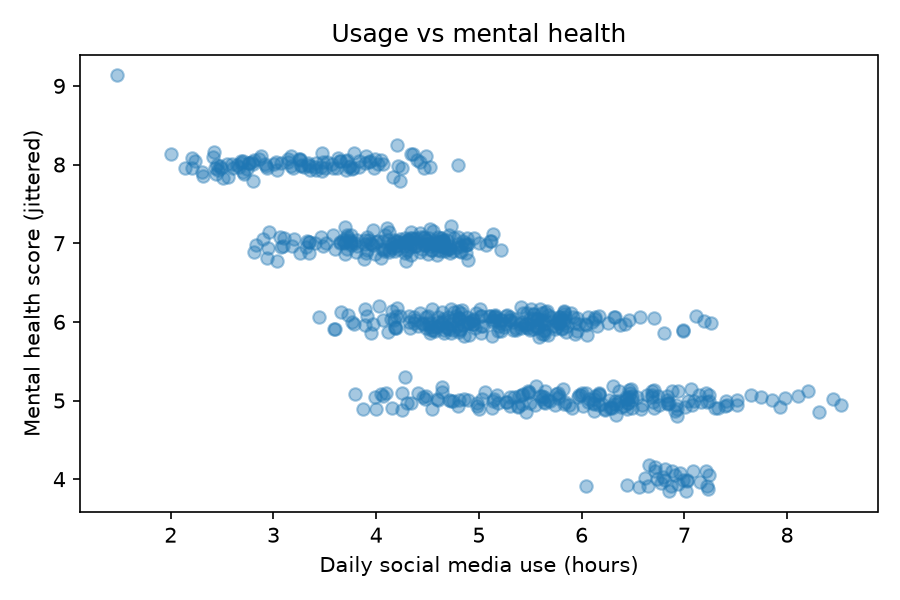
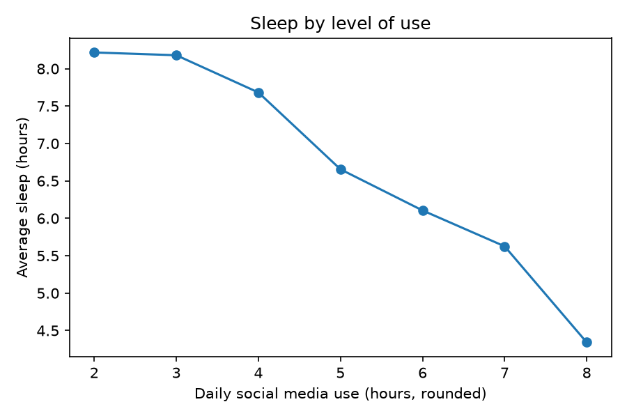
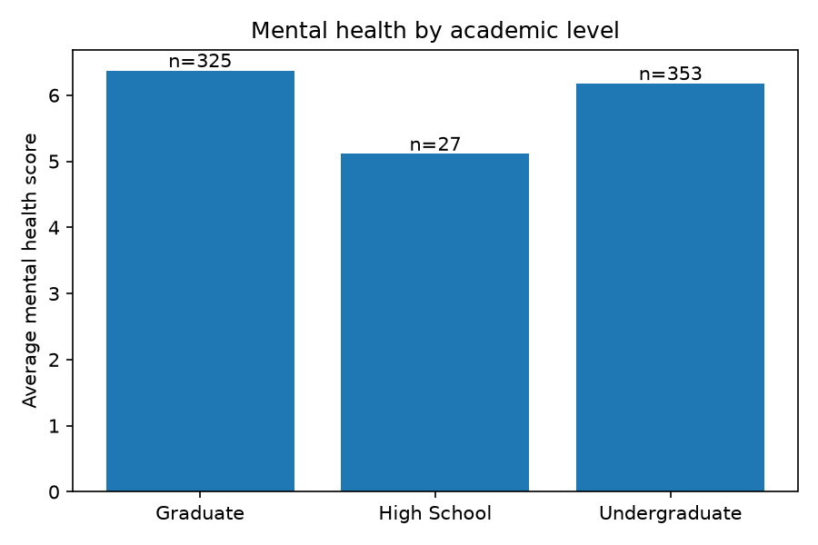
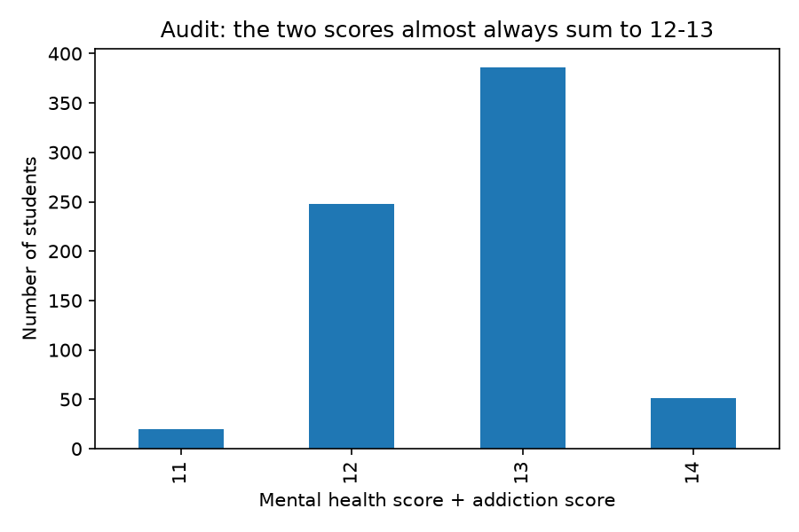

# Social Media Use and Student Wellbeing: Analysis and Data-Quality Audit

An analysis of an open Kaggle student survey (705 students), asking whether more
daily social media use goes together with less sleep and lower self-reported
mental health, **and whether the data itself can be trusted**.

## Research questions
1. **RQ1.** Is daily social media use associated with mental health score and sleep?
2. **RQ2.** Does sleep explain part of the link between use and mental health?
3. **RQ3.** Do averages differ by gender or academic level?
4. **RQ4 (data quality).** Do the variables behave like independent real survey answers?

## Data
- Kaggle: "Student Social Media Addiction Analysis Dataset" (zahranusratt)
  https://www.kaggle.com/datasets/zahranusratt/student-social-media-addiction-analysis-dataset
- 705 rows, 13 columns. Licence: _(fill in from the Kaggle page)_. Downloaded: _(date)_.
- The raw CSV is not stored in this repo. Download it into `data/`.

## How to run
```bash
pip install -r requirements.txt
# put the CSV at data/Students_Social_Media_Addiction.csv
python analysis.py
```
Output: printed results, `results/summary.txt` and 4 charts in `results/`.

## Method
- Data-quality audit (duplicates, missing values, ranges, score consistency, sample structure)
- Spearman correlations with bootstrap 95% confidence intervals
- Partial correlation (usage vs mental health, controlling for sleep)
- Group averages by gender and academic level

## Findings
- **Use and mental health:** strong negative association (Spearman -0.80, 95% CI -0.83 to -0.77).
- **Use and sleep:** strong negative association (-0.81); sleep and mental health are positively related (+0.73).
- **Role of sleep:** controlling for sleep reduces the use/mental-health association
  from -0.80 to -0.52 (95% CI -0.57 to -0.46). Sleep accounts for part of the link,
  but not all of it.
- **Groups:** little difference by gender (mean mental health 6.18 female, 6.28 male).
  High-school students score lowest (5.11) but there are only 27 of them.


## Visual Results

### 1. Social Media Usage vs Mental Health


### 2. Social Media Usage vs Sleep


### 3. Mental Health by Academic Level


### 4. Data Quality Audit


## Data-quality audit (important)
- The mental health score and the addiction score are near mirror images
  (Spearman -0.95). Their sum is always 11-14, and 90% of students sum to 12 or 13.
  Independent self-reports rarely line up this tightly, so I did not use the
  addiction score as separate evidence.
- The sample is unusually tidy: 353 female vs 352 male students, 110 countries
  (79 with 5 or fewer students), and "High School" students aged 18-20.
- The dataset page does not document how the data was collected.
- **Conclusion:** the results describe *this dataset*. They should not be taken
  as evidence about students in general until replicated on data with a documented
  collection method.

## Limitations
- Cross-sectional survey: association, not cause and effect.
- Self-reported scores on short ordinal scales.
- Unknown sampling method; possible synthetic or engineered data (see audit).
- Small groups (high school n=27; most countries n<=5) prevent reliable comparisons.

## Ethics
Public, anonymised data only. No individuals were contacted. This is a statistical
exercise, not a diagnostic or therapeutic tool.

## Next steps
- Repeat the analysis on a dataset with documented collection (e.g. IEEE DataPort).
- Compare whether the same patterns appear.
